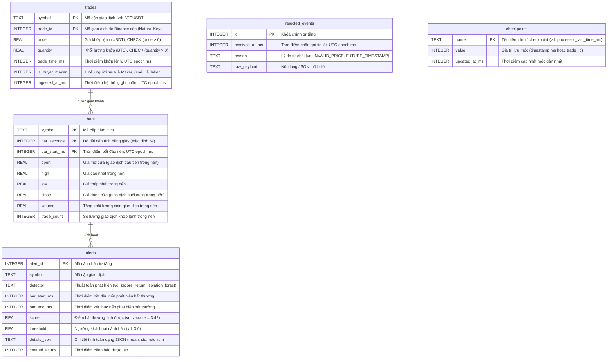

# DATA DICTIONARY — Từ Điển Dữ Liệu & Sơ Đồ Thực Thể (ERD)

Tài liệu này đặc tả chi tiết toàn bộ các bảng, các trường, kiểu dữ liệu, ràng buộc và sơ đồ quan hệ dữ liệu trong hệ thống **Real-time Anomaly Detection Pipeline**.

---

## 1. Sơ đồ Quan hệ Thực thể (ERD)

---

## 2. Đặc Tả Chi Tiết Từng Bảng

### Bảng 1: `trades` (Giao dịch khớp lệnh hợp lệ)
Lưu trữ toàn bộ các giao dịch riêng lẻ nhận từ sàn Binance đã vượt qua bước kiểm tra tính hợp lệ.

| Tên cột | Kiểu SQLite | Ràng buộc | Đơn vị | Ý nghĩa | Ví dụ |
|---|---|---|---|---|---|
| `symbol` | `TEXT` | `NOT NULL` | - | Cặp giao dịch tiền mã hóa | `"BTCUSDT"` |
| `trade_id` | `INTEGER` | `NOT NULL` | - | ID duy nhất do sàn Binance cấp (Khóa tự nhiên) | `6791836347` |
| `price` | `REAL` | `NOT NULL, CHECK (price > 0)` | USDT | Giá khớp lệnh của 1 đồng coin | `80130.00` |
| `quantity` | `REAL` | `NOT NULL, CHECK (quantity > 0)` | Coin (BTC) | Số lượng coin được mua/bán trong lệnh | `0.00233` |
| `trade_time_ms` | `INTEGER` | `NOT NULL` | ms | Thời điểm khớp lệnh trên sàn (UTC epoch milliseconds) | `1792998879167` |
| `is_buyer_maker` | `INTEGER` | `NOT NULL, CHECK (IN (0, 1))` | Boolean (0/1) | `1`: Bên bán chủ động xả; `0`: Bên mua chủ động gom | `1` |
| `ingested_at_ms` | `INTEGER` | `NOT NULL` | ms | Thời điểm pipeline của chúng ta nhận và ghi bản ghi | `1792998879200` |

- **Khóa chính (PRIMARY KEY):** `(symbol, trade_id)` — Đảm bảo tính Idempotency: dù nạp lại dữ liệu bao nhiêu lần cũng không bao giờ bị trùng lặp.
- **Index:** `idx_trades_symbol_time ON trades (symbol, trade_time_ms)` — Tăng tốc tối đa cho các truy vấn lọc giao dịch theo dải thời gian khi dựng nến.

---

### Bảng 2: `rejected_events` (Cách ly dữ liệu lỗi / Dead-Letter Queue)
Lưu lại toàn bộ payload không hợp lệ để phục vụ truy vết lỗi và đảm bảo chất lượng dữ liệu.

| Tên cột | Kiểu SQLite | Ràng buộc | Ý nghĩa | Ví dụ |
|---|---|---|---|---|
| `id` | `INTEGER` | `PRIMARY KEY AUTOINCREMENT` | ID tự tăng định danh lỗi | `1` |
| `received_at_ms` | `INTEGER` | `NOT NULL` | Thời điểm nhận gói tin lỗi (epoch ms) | `1792998880000` |
| `reason` | `TEXT` | `NOT NULL` | Mã lỗi phân loại lý do từ chối | `"PRICE_NON_POSITIVE"`, `"FUTURE_TIMESTAMP"` |
| `raw_payload` | `TEXT` | `NOT NULL` | Chuỗi JSON nguyên bản do nguồn gửi tới | `{"price": "-10.5", ...}` |

---

### Bảng 3: `bars` (Nến tổng hợp theo thời gian)
Lưu trữ các thanh nến thời gian (OHLCV) được tổng hợp từ các giao dịch riêng lẻ trong mỗi chu kỳ thời gian (mặc định 5 giây).

| Tên cột | Kiểu SQLite | Ràng buộc | Đơn vị | Ý nghĩa | Ví dụ |
|---|---|---|---|---|---|
| `symbol` | `TEXT` | `NOT NULL` | - | Cặp giao dịch | `"BTCUSDT"` |
| `bar_seconds` | `INTEGER` | `NOT NULL` | giây | Khung thời gian của nến (Timeframe) | `5` |
| `bar_start_ms` | `INTEGER` | `NOT NULL` | ms | Mốc thời gian bắt đầu cây nến (làm tròn bội số 5s) | `1792998875000` |
| `open` | `REAL` | `NOT NULL` | USDT | Giá của giao dịch đầu tiên xuất hiện trong nến | `80120.00` |
| `high` | `REAL` | `NOT NULL` | USDT | Giá cao nhất đạt được trong chu kỳ nến | `80150.00` |
| `low` | `REAL` | `NOT NULL` | USDT | Giá thấp nhất đạt được trong chu kỳ nến | `80110.00` |
| `close` | `REAL` | `NOT NULL` | USDT | Giá của giao dịch cuối cùng trong nến | `80145.00` |
| `volume` | `REAL` | `NOT NULL` | Coin (BTC) | Tổng khối lượng coin được giao dịch trong nến | `12.45` |
| `trade_count` | `INTEGER` | `NOT NULL` | Lệnh | Tổng số lượng giao dịch đã khớp trong nến | `142` |

- **Khóa chính (PRIMARY KEY):** `(symbol, bar_seconds, bar_start_ms)` — Mỗi cây nến tại một khung giờ chỉ tồn tại duy nhất một bản ghi.

---

### Bảng 4: `alerts` (Lưu vết các cảnh báo bất thường)
Lưu trữ thông tin các sự kiện bất thường được phát hiện bởi các thuật toán thống kê (Z-Score) hoặc mô hình học máy (Isolation Forest).

| Tên cột | Kiểu SQLite | Ràng buộc | Ý nghĩa | Ví dụ |
|---|---|---|---|---|
| `alert_id` | `INTEGER` | `PRIMARY KEY AUTOINCREMENT` | ID định danh cảnh báo | `1` |
| `symbol` | `TEXT` | `NOT NULL` | Cặp giao dịch xuất hiện bất thường | `"BTCUSDT"` |
| `detector` | `TEXT` | `NOT NULL` | Tên bộ phát hiện bất thường | `"zscore_return"`, `"isolation_forest"` |
| `bar_start_ms` | `INTEGER` | `NOT NULL` | Thời gian bắt đầu cây nến bị bất thường | `1792998875000` |
| `bar_end_ms` | `INTEGER` | `NOT NULL` | Thời gian kết thúc cây nến bị bất thường | `1792998880000` |
| `score` | `REAL` | `NOT NULL` | Điểm số bất thường thực tế tính được | `3.42` |
| `threshold` | `REAL` | `NOT NULL` | Ngưỡng kích hoạt quy định | `3.0` |
| `details_json` | `TEXT` | `NOT NULL` | Chi tiết thống kê bổ sung (dạng JSON) | `{"mean": 80100.0, "std": 12.5, "z": 3.42}` |
| `created_at_ms` | `INTEGER` | `NOT NULL` | Thời điểm phát hiện và ghi nhận cảnh báo | `1792998880150` |

- **Ràng buộc duy nhất (UNIQUE CONSTRAINT):** `UNIQUE (symbol, detector, bar_end_ms)` — Chống spam cảnh báo: mỗi thuật toán chỉ được phát 1 cảnh báo duy nhất cho một cây nến.
- **Index:** `idx_alerts_time ON alerts (bar_end_ms)` — Tối ưu cho API truy vấn danh sách cảnh báo gần nhất.

---

### Bảng 5: `checkpoints` (Lưu trạng thái tiến trình)
Lưu vết trạng thái tiến trình (watermark) giúp hệ thống khi khởi động lại (restart) biết chính xác cần tiếp tục xử lý từ đâu mà không bị lặp hay bỏ sót.

| Tên cột | Kiểu SQLite | Ràng buộc | Ý nghĩa | Ví dụ |
|---|---|---|---|---|
| `name` | `TEXT` | `PRIMARY KEY` | Tên của checkpoint | `"processor_last_bar_time"` |
| `value` | `INTEGER` | `NOT NULL` | Giá trị mốc đã xử lý xong (timestamp ms) | `1792998875000` |
| `updated_at_ms` | `INTEGER` | `NOT NULL` | Thời điểm cập nhật mốc | `1792998880200` |
